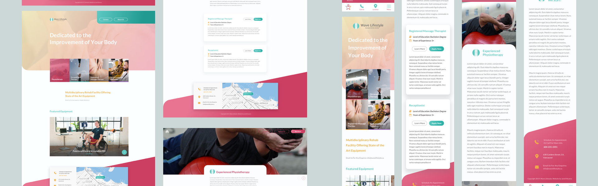
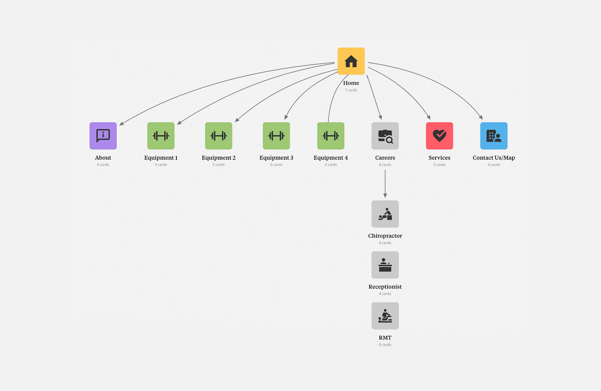
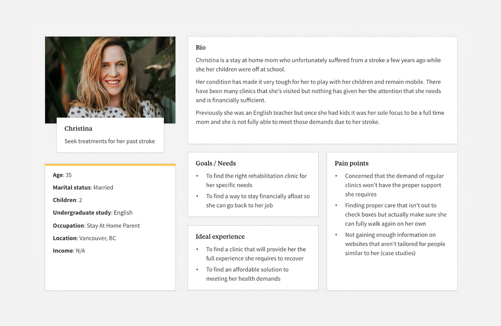
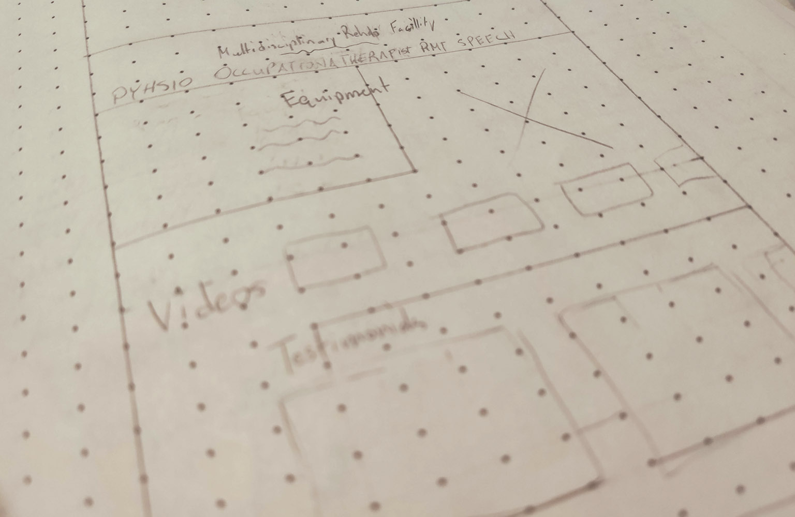
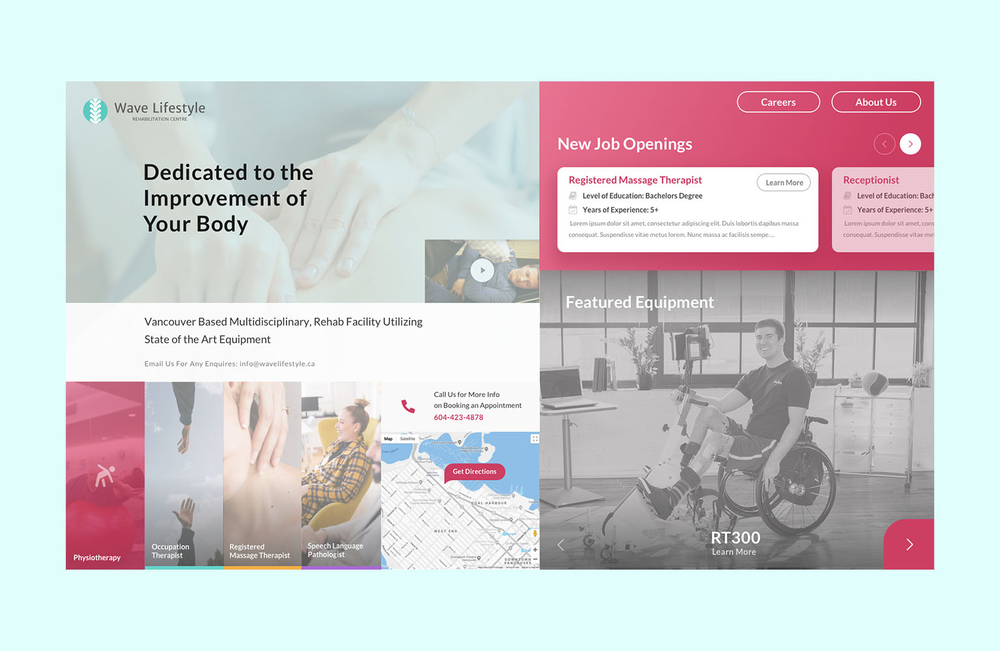
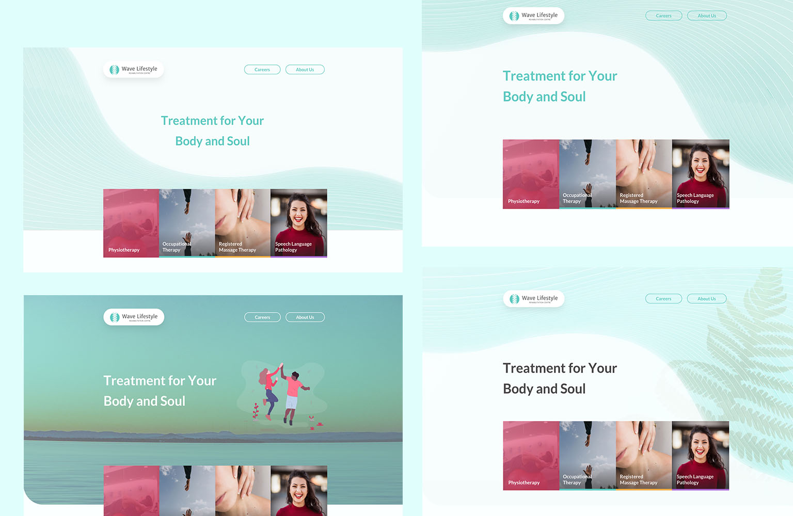
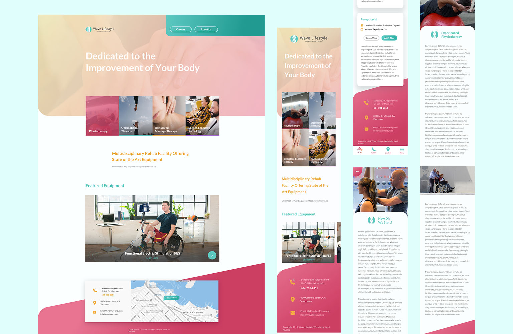
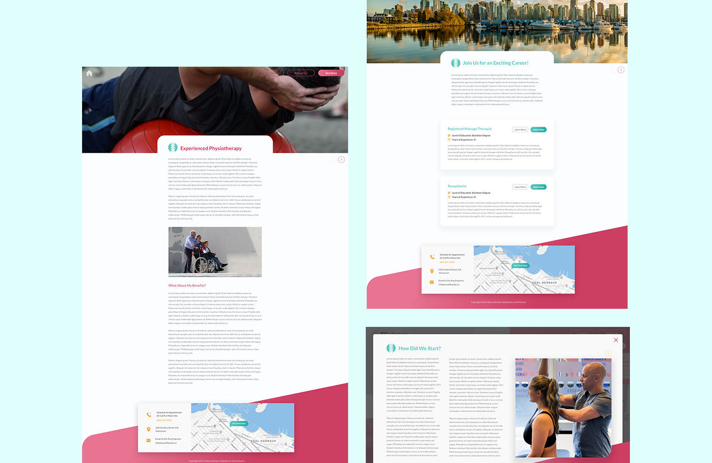

<!-- Written in 2019 and kept as it was. -->

*Written in 2019 and kept as it was.*

## Overview

With this project, I had to learn all about the world of chiropractic care. The clinic does three-hour sessions specializing in patients with physical limitations. **The Problem:** Altogether, they needed a fresh look that would have them stand out, convert users to new dedicated clients, or book sessions for loyal ones. This was a cause I felt like I could get behind.

## Client Discovery Session

During our meeting I received a website from a clinic based in California that would be my primary inspiration for their highly specialized clients. They admitted to me that the site’s function, up to this point, was to generate leads for the occasional job application and a landing page for their contact information.

### Main Objectives

After several meetings and correspondence my objectives became the following:

- Convey who they are in a direct way

- Simplify and market their specialized treatments and equipment

- Show off current pictures of their space

- Make the site optimized for performance while still being user-friendly and convey a message of hope and trust

- Create a unique design

- Keep the pains and symptoms of their clients at the top of mind, as I developed their web experience.

- Satisfy an exacting client.

## Understanding Site Structure Through Competition Analysis

My research began with looking at local competitors and understanding the needs they were meetings. Most clinics were using basic landing pages and most use some form of appointment booking service like JaneApp. After I examined the key differences and similarities between the websites I proceeded to compile a checklist with headings for things that I believed each was missing. These included pages and features such as youtube videos, testimonials, case studies, professional machines available, treatments, about us and careers page.

## Digging For User Insights

I then looked at these sites through the lens of Facebook and Google Reviews to see what needs, if any, customers were discussing online. With this information, I developed the basis of my personas. I also spent some time reading client case studies to better understand the patients who would be using the site. Ultimately I felt that I was well equipped to translate their needs and address their pain points.

## Building Out Persona’s and Statements

To help focus my persona’s, I created statements developed from the information that I had gleaned. I used them to further clarify their situation and narrow what kind of solution I would attempt to offer. This helped me develop content and helped steer the visual language and functionality of the site to a more focused endpoint.

**Statement 1:** Christina, an ambitious multitasker and mother of two **needs** to confidently trust a clinics ability to go beyond the expectations **in order** to seek treatments for her previous stroke. **Statement 2:** Tech savvy College student Joey **needs** to find the right rehabilitation clinic that will help cover the expensive costs **in order** to be a fully healthy functional member of society again and focus on classes. **Statement 3:** John, recently laid off single father of one **needs** to find a clinic that doesn’t require benefits and can help his son from a chronic muscle injury **in order** to see that he can live a normal healthy life and not rack up debt.

## Scope and Constraints

My client wanted to time the website with the construction of their clinic and agreed on a **four week ** time frame for four deliverables: initial mockup and edits, final mockup, initial developed site and edits, and final website.

## Shaping Designs for Users Needs

After all my user research was complete it was time to start wireframing starting with mobile.

After a few email exchanges with the client I was able to create a nice skeleton of which elements should take precedence of each other using my personas as a research method to help me make these layout and design choices. Once I got those sorted out it was time for my initial high fidelity designs.

## Finding Balance for Clients Needs

After receiving edit notes on the initial mockup, they requested more prominence from their logo, so I ensured that the colours complemented the logo properly. The aesthetic choices were based on current trends while paving the way for any future ones. Since this website, fundamentally, traded in hope as an ideal, I wanted to minimize the corners while adding some fun colour and shaping to put the user at ease. A feature of the homepage the client enjoyed was the look and feel of the footer.

Once I received final approval for the mockups, we moved on to development.

## Ending Results and New Perspectives

The website was ready to launch but was never granted the final approval in the end. We parted ways on good terms and kept in touch to ensure that they had options and had a gameplan. Key takeaway lessons included planning out the terms for a deposit up front or doing more check-ins with the client to ensure we’re on the right track will be priority number one. This was pushing my limits on deliverables and would have preferred committing more time into user research such as user flow and interviews. For websites that are time-sensitive, it will be imperative to prioritize my schedule and value my time instead of appeasing tight deadlines. Overall I’m happy with the product that I made and will be effective at freelancing next time.
