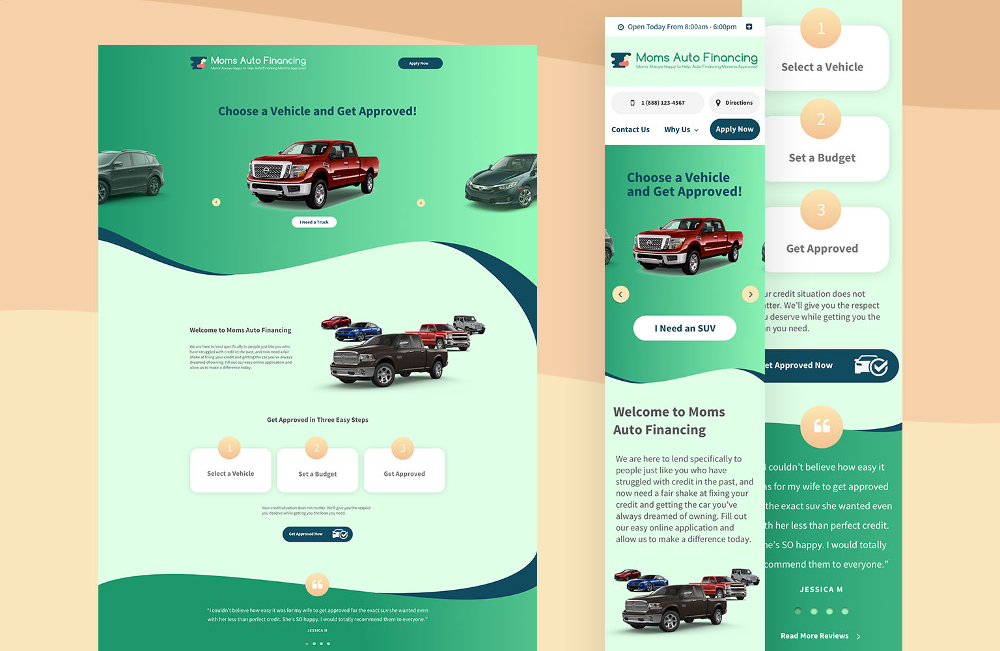
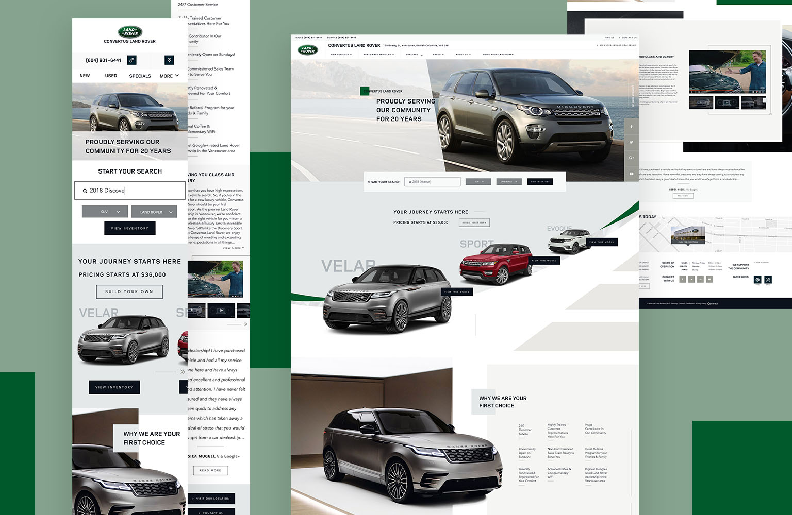
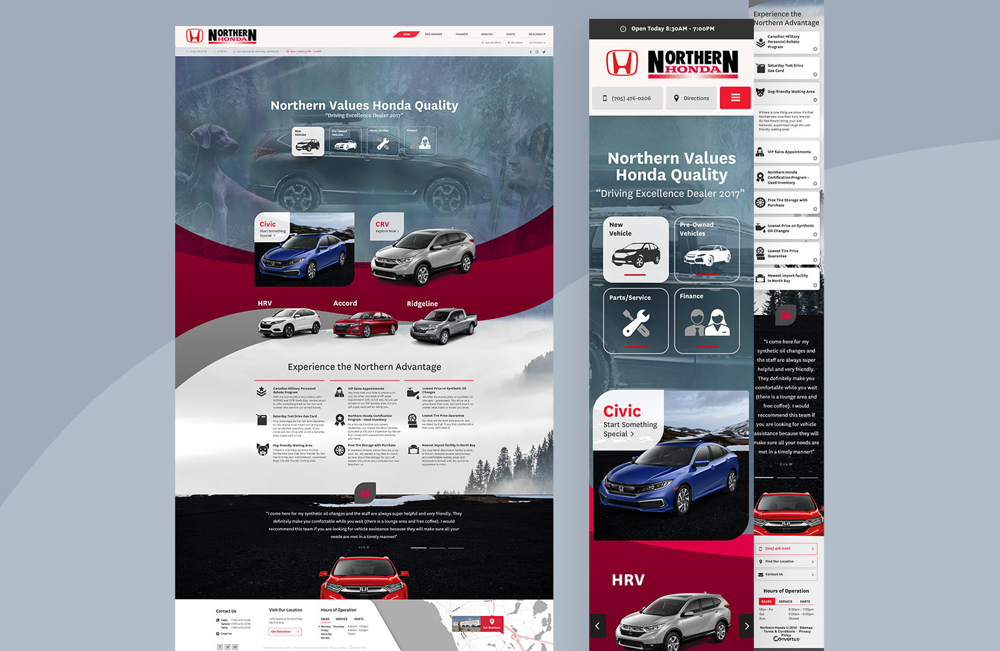
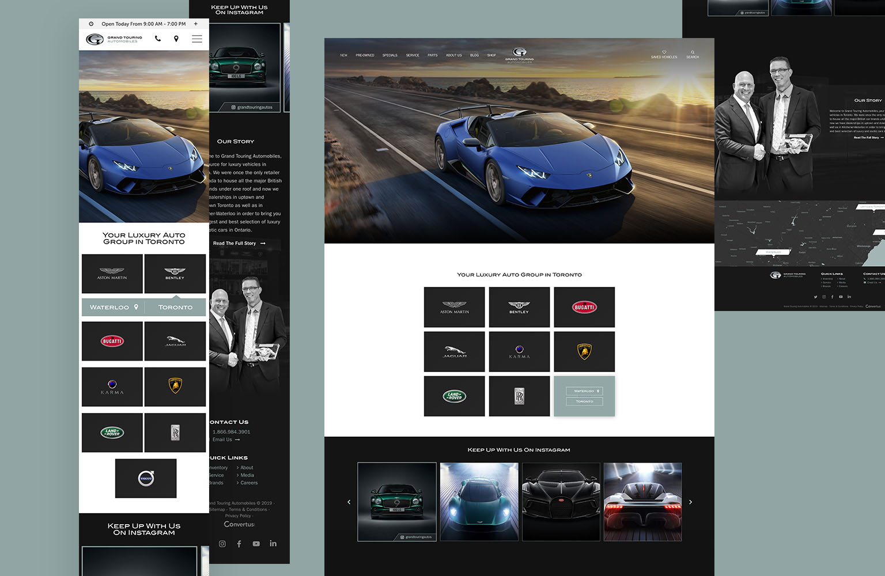
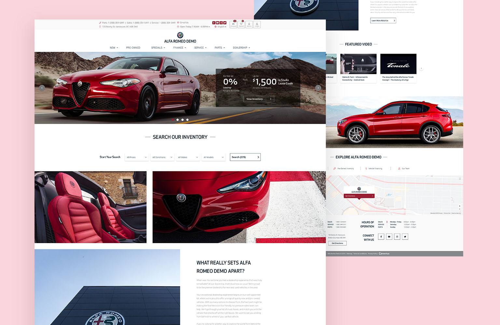
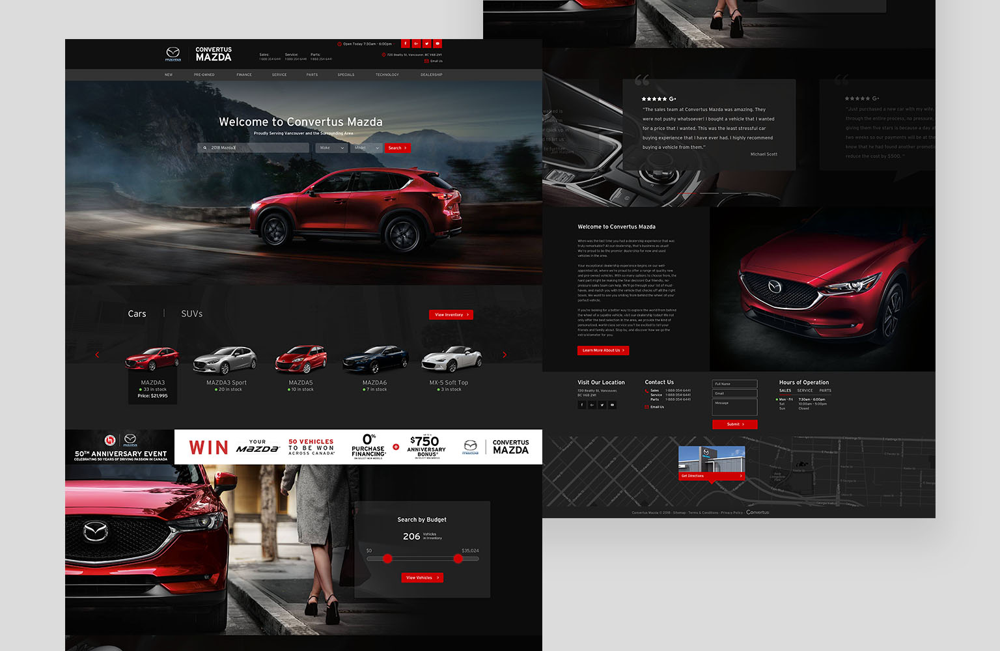
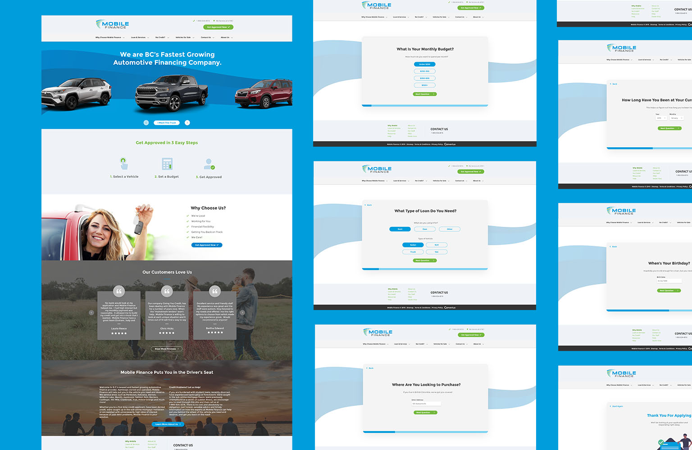

<!-- Written in 2019 and kept as it was. -->

*Written in 2019 and kept as it was.*

## Redesigning the Automotive Industry

The automotive industry is a stale, aging industry and a lot of their websites show it. During my time at Convertus, I was responsible for creating mockups for various clients which included homepages, forms, back-end portals, landing pages etc. Some client requests were absurd, and branding for dealerships meant their favourite colour: #FF0000 or designs that “POP!”. My job was to minimize their pain points and identify what they actually needed for their site, even if they didn’t know it yet within tight deadlines. Here’s a collection of my favourite designs from RFP’s (Request for Proposals) with Land Rover Canada, Mazda Canada and FCA (Alfa Romeo, RAM, Dodge, Fiat), dealership sites and more.

