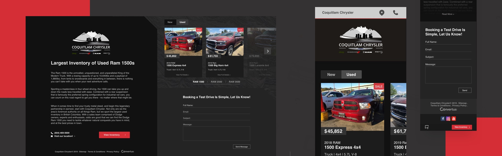
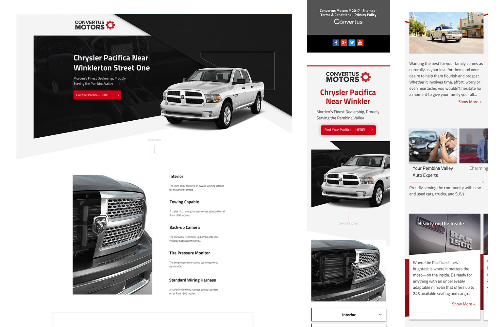
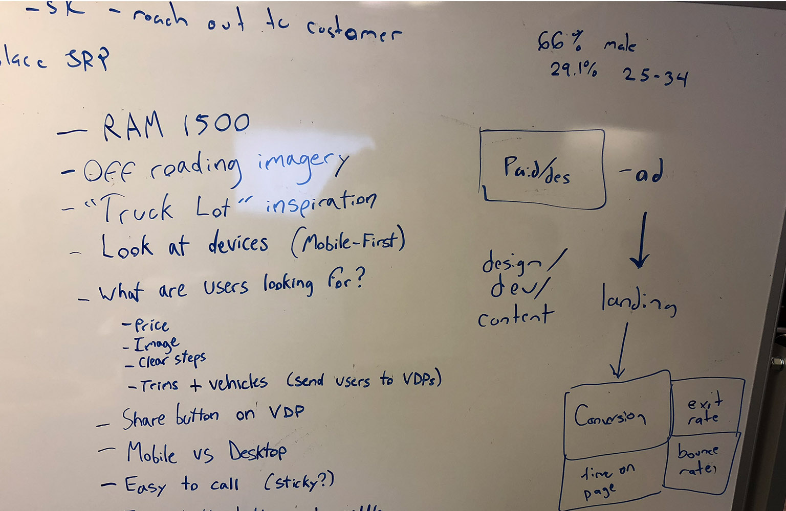
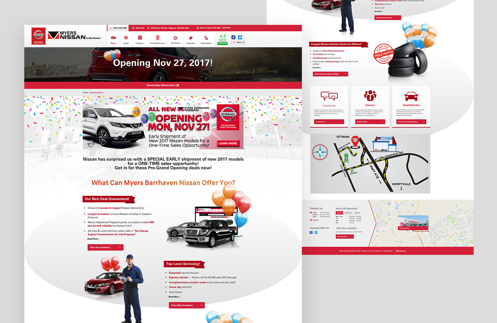
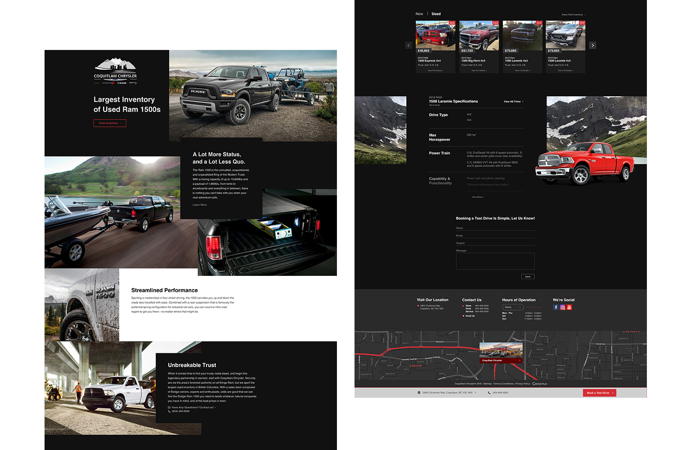
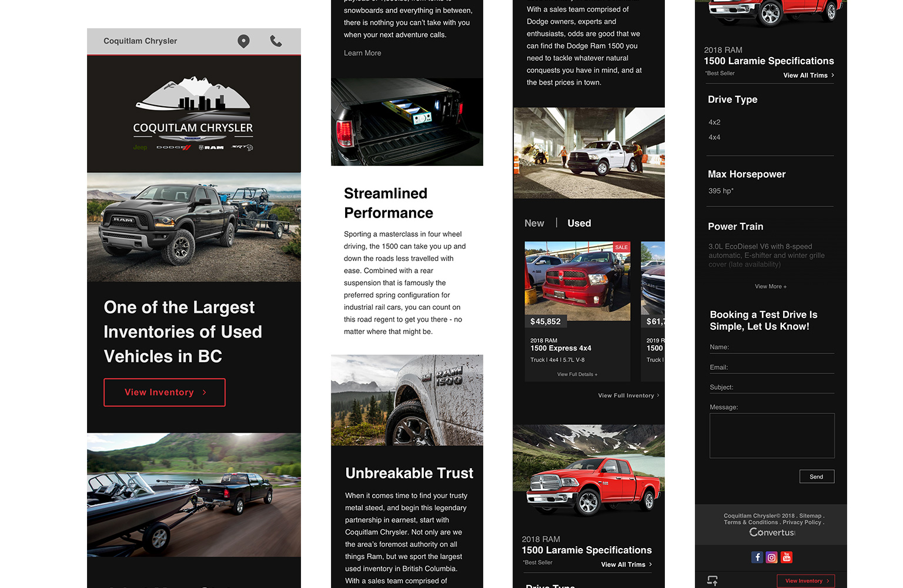
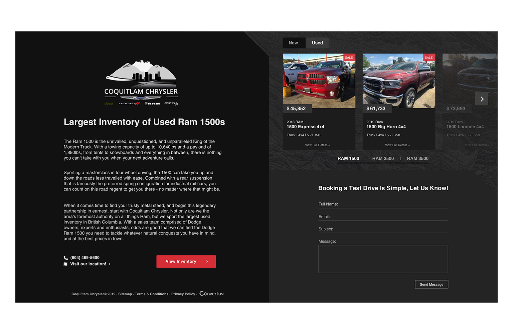
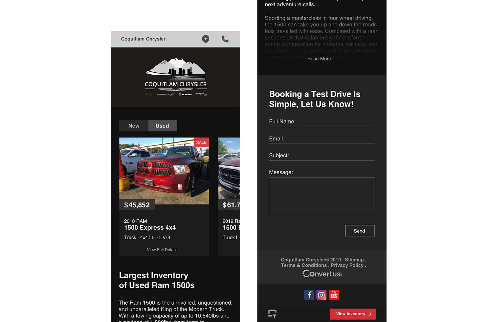

<!-- Written in 2019 and kept as it was. -->

*Written in 2019 and kept as it was.*

## Overview

The concept was simple: provide a premium service that outshined other automotive marketing agencies and beat them at SEO, Websites, Paid Search and Social Ads. Once Convertus was acquired by Autotrader in 2018, we continued to build relationships with major auto groups around Canada and land huge partnerships with OEMs (original equipment manufacturing) such as Volkswaggen, FCA, Land Rover Jaguar etc. **The Problem:** Convertus’ landing pages had been stale for the last few years. Most were custom made for clients or didn’t drive enough traffic to customers vehicle display pages. My job was to fix this.

Previous Viridian Landing Page I designed

## Main Objectives

I was in charge of revamping our current design and providing our clients better value and converting more users to customers. This project’s main goals were focusing on identifying our users, understanding their wants/needs and applying those to the end product. **Main Milestones:**

- Make CTA more prominent and efficient

- Divert traffic to vehicle display pages

- Add in features to allow ease of conversion on mobile browsing vs desktop research

- Measure the performance increases from a paid search and website perspective

- Testing largest customer groups or “buckets” with new layouts, imagery etc. that spoke to them before committing to any one design.

Now it was important to clarify the types of data I needed for comparison. Without these success metrics (as the name implies) it wouldn’t be possible to know if the redesign worked. **Success Metrics:**

- Driving traffic to our product page with a carousel of images

**- Performance:** CTA, CTR, Conversions, bounce rate, exit rate, time on page

**- Cost:** Time and resources in addition to actual capital

**- Scaleability:** If performance is exceptional given the changes, how can we scale this company-wide? Is it worth the upheaval?

Brainstorming User Needs and Groups

## Users and Audience

For the test case, we categorized our user groups during our brainstorming sessions and found our largest group: 25-35 suburban males who are interested in trucks. The top-selling vehicles in America are the RAM 1500, Chevrolet Silverado and F-150 appeal to 25-35 year olds since it gives them flexibility, reliability, comfort, and large payload making them the kings of the market. The U.S. automotive market tells a different tale, indicating buyers are into the F-150 and appeal to an older 50+ year old customer base (reference).

## My Role and Responsibility

While I began the project as lead designer, I soon took over as project coordinator. I was in charge of coordinating multiple tasks for various teams in Paid Search, Web Development, SEO Landing Pages, Customer Success, and Content culminating in a team of over 10 people across the company.

## Project Scope and Constraints

I had access to all our teams resources and a six month timeline to design the design, manage the build and collection data from our test pages. This tied into campaigns for paid and social that I designed to attract customers to our test page.

## Designing a Safer, Fun Landing

I began by researching our users and reexamining our older landing page designs through the lens of our new targeted version. Hotjar was our primary source of data and helped me indicate where the problems with our older, less templated, pages lied.

Previous custom landing pages

- The old sites troubles needed a desperate need for flashier designs and animations to help draw-eyes to important content.

- Inclusion of an easily accessible CTA button.

## Turning Ideas Into Functioning Mockups

In taking those findings into account, I created several versions of high fidelity wireframes to get them tested and approved by other team members. I added several new features such as:

- Emailing link to yourself in mobile

- Pop up to allow number to directly called phone

- Working phone and map links for mobile & desktop (previously opened facetime or exited site)

- Specs of vehicle laid out at the bottom (inspired by Apple’s site)

- Sticky header and footer with prominent buttons

- Darker colours, imagery and CTA targeted to a “fun and edgy” user base

- Designed mobile first

Initial Landing Page Desktop and Mobile

## Test, Test, Test Again

After several months of testing with our metrics in mind, the results weren’t positive. Engagements based on events and bounce rates were low, and I needed to test two different landing pages at the same time. This included a simpler design that could feature different models of vehicles such as RAM 2500 and 3500 to give users options.

Multiple Single Page Versions

## One Page Design Solution

One page landing pages allow users increased engagement with a prominent CTA, allow link outs to various vehicle listing pages, convert easily for mobile and is scalable for thousands of landing pages targeting different users.

## Outcomes and Learnings
