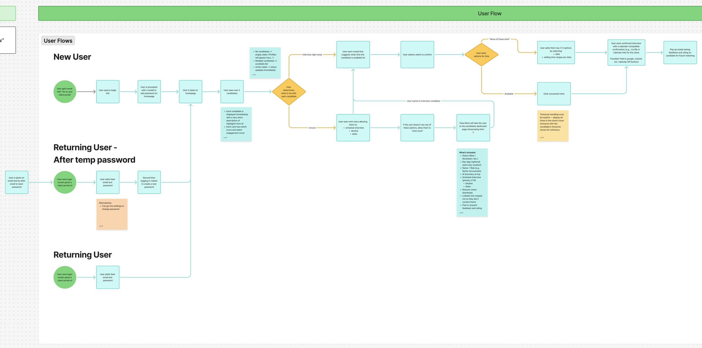
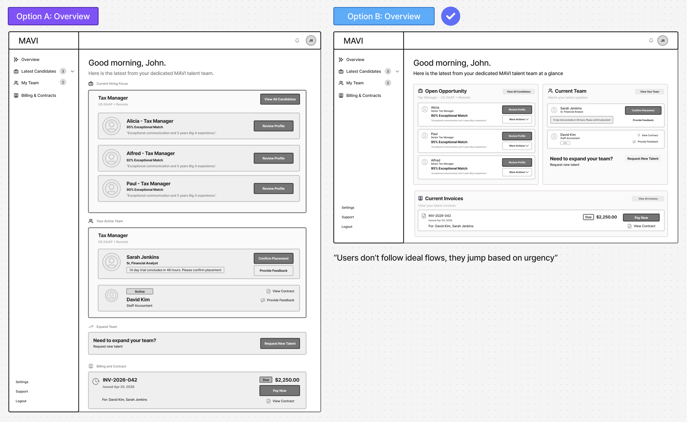
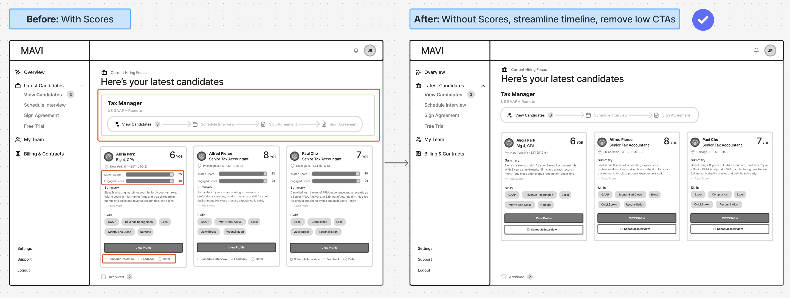
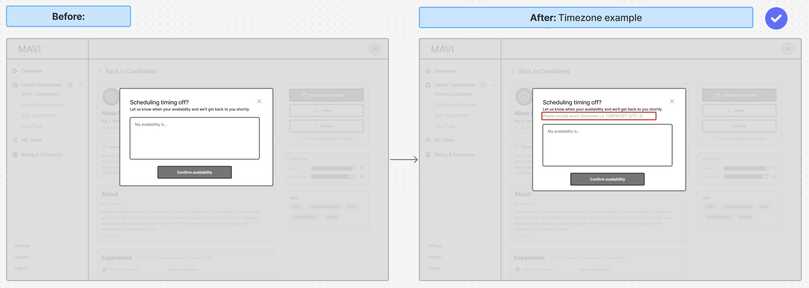
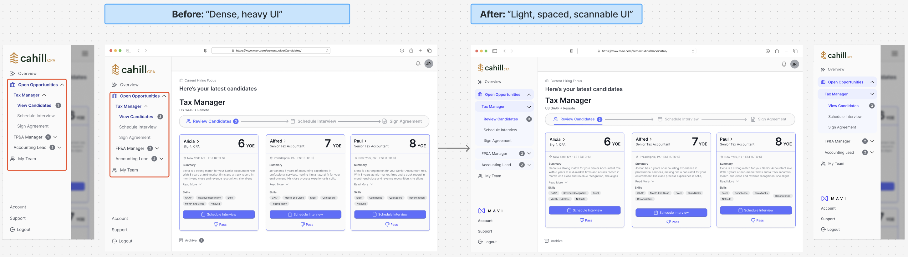
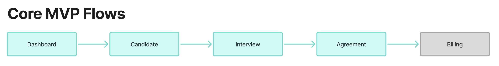

<!-- DRAFT 1. Every fact comes from Jarell's case study doc. Names are replaced with roles.
     Lines marked [JARELL] are questions, not copy. -->

## Overview

MAVI places talent with client companies. Clients were running the whole hiring process through email, manual coordination and a handful of disconnected tools. They couldn't see where things stood, and almost every step needed someone at MAVI to push it along.

I led design on a new client portal: one place to review candidates, book interviews, sign agreements and keep track of the people they've hired.

<b>12 days</b>from brief to high-fidelity screens ready for build

<b>5 groups</b>aligned on one direction: product, platform, sales, customer success, leadership

<b>3 actions</b>in the first release, with everything else deferred

**What I delivered**

- End-to-end design of the portal, from user flow to high-fidelity screens for the core flows
- An MVP scoped down to three actions: review candidates, schedule interviews, sign agreements
- A direction that the PM, Platform, Sales, Customer Success and our co-founder all signed off on before build

**What changed along the way**

- Removed a metric that looked helpful but would have created doubt for clients.
- Cut the main decision screen down to two choices.
- Dropped a guided, step-by-step flow. People act on whatever is urgent, so nothing is gated.
- Turned the post-hire area from a list into a working hub.

**How success gets measured**

- How quickly new clients get set up
- How fast clients review and act on what they're sent
- Time between each step of the hiring process
- How much less the MAVI team has to follow up by hand, which is the main one

[JARELL] Results go here once the portal is live and measured. Ask me later.

<!-- lock -->

## The problem

Hiring through MAVI worked, but it lived in inboxes. A client would get candidate profiles by email, reply with thoughts, go back and forth on interview times, then chase a contract. Nobody on the client side could answer "where are we?" without asking.

That cost three things: slower decisions, a disjointed experience, and a lot of MAVI's time spent nudging.

The brief was a self-serve portal that covers the whole hiring lifecycle and is simple enough for an MVP but can grow.

## Decision 1: two versions, then merge

I started from the product spec and built a clickable first version: a modular, data-rich dashboard designed to scale.

Our PM built a parallel version at the same time, focused on what a client would realistically do in a first release.

Mine was more complete. His was closer to how people would use it. We put them side by side and merged: keep the strong components from mine, strip the complexity his version showed we didn't need.

What came out of it:

- A dashboard built around 1 to 3 active candidates, not a dense overview
- Card-based, modular UI so it can grow later
- A simpler pipeline view
- Larger, plainer cards in My Team

## Decision 2: take it to the people who talk to clients

With the PM aligned, we took the wireframes to our Platform lead, Sales and Customer Success. I wanted to know if the design matched how clients behave, and what had to happen behind the scenes for it to work.

That session changed the product more than any other.

**Dashboards shouldn't force an order.** I'd designed a guided progression. The feedback was that clients would get confused if pushed through steps. People act on what's urgent. We moved to a dashboard where everything is visible and nothing is gated.

**The match score had to go.**

> A 20% match looks terrible and we cannot explain that to customers.

I'd added it to help clients scan. It did the opposite. A number without an explanation creates doubt, and it competes with the client's own judgment. We removed it completely.

**Candidate cards are for triage.** The AI summary, skills and years of experience stayed. The card's job is to help you decide who to open, not to make the hire.

**Scheduling is a negotiation.** Clients needed to see time zones clearly and to offer their own availability when none of the candidate's times worked. I added both, plus a fallback to request more times or contact MAVI.

**My Team is where trust is kept or lost.** Customer Success pushed hard on this. Timesheets, trial status and ongoing feedback matter more after the hire than before it. My Team became the operational hub, with a "need more capacity" action to start a new hire.

## Decision 3: guide the decision, cut the rest

Engineering feedback and another round with the PM showed the candidate cards were still doing too much. View profile, give feedback, proceed, pass: four actions competing on every card.

I cut it to two primary actions, proceed or pass. Viewing the profile moved to a hover, feedback to a modal. Feedback prompts moved too, from right after scheduling to after the interview, when the client has something to say.

## Decision 4: the MVP is what you leave out

The first hi-fi pass felt heavy. Big elements, tight spacing, weak hierarchy in the navigation. Our co-founder's reaction was that it needed to feel lighter.

I reduced text sizes, opened up spacing and used subtle background color to separate navigation from content.

Scope got the same treatment. Billing, messaging and the advanced dashboard were all on the table. We deferred them. The first version does three things: review candidates, schedule interviews, sign agreements.

I also stopped designing every screen in hi-fi. I picked the ones that would expose problems and align people: candidate pipeline, profile, feedback, scheduling, sign-up and navigation states.

## Where it stands

The designs were reviewed by product, engineering, platform and leadership and handed off for build.

[JARELL] This is where the dev story would go. Your call on how much to say. Options: leave it at "handed off", or one honest line like "The first build didn't match the designs, so development restarts later in 2026."

## What I learned

**A simpler version from someone else is a gift.** The PM's parallel build showed me where mine was solving for a future that hadn't arrived yet.

**Helpful numbers can hurt.** The match score looked like clarity. To the people who'd have to explain it, it was a liability.

**Alignment was the slow part, not design.** The work that moved things forward was getting five groups to the same understanding, with focused screens, recorded walkthroughs and one final review.
