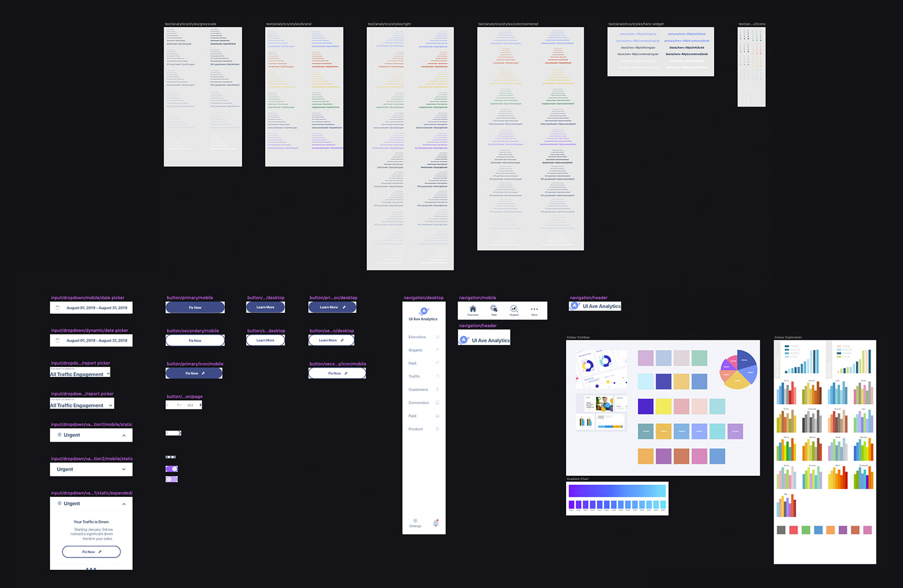

## At a glance

UI Avenue was a small team of developers, designers and marketers building apps for Shopify store owners. Our first product was an analytics app that turned Google Analytics into reports a busy owner could read.

I led the design: research, onboarding, wireframes, the design system and the final product.

The app launched. A few months later, in mid-2020 at the start of the pandemic, UI Avenue closed. What follows is the write-up from 2019, as I wrote it then.

## Overview (2019)

Shopify is empowering independent business owners everywhere, generating billions in sales every year. With award winning support, app store and experts, we’ve set out to help owners all across the world grow and connect with their customers. UI Avenue is a small company comprised of developers and designers who have worked at a digital marketing agency for years. We’ve set out to capitalize on this platform by building business’ brands by understanding their needs and growing their online presence with a better experience. We’ve created a business intelligence app aimed to solve the complexities of google analytics with a helpful data reporting system for business’ that actually make sense of data. **Problem:** Google Analytics is very confusing, and provides data without clear purpose.

## Exploring the Competition

Discovering who will use our app meant doing a deep dive into our competition. There were only two major players in the shopify store and both had five stars with hundreds of reviews.

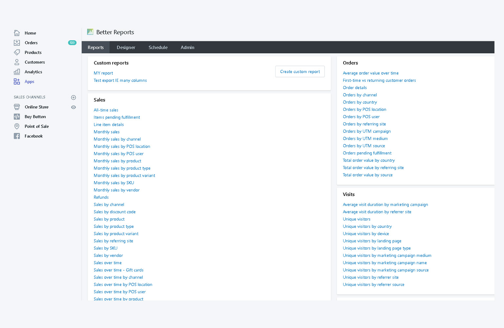

Our first competitor had 200+ reviews with a 4.5 rating but their homepage consisted of two columns listing every type of data out there and was a disheveled mess.

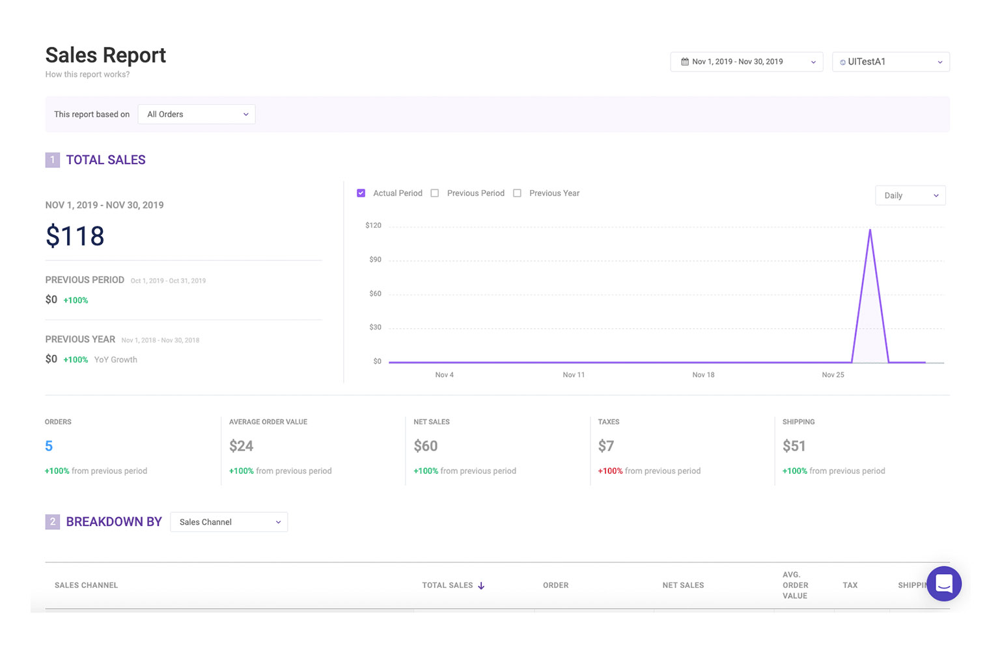

Our next competitor had a stronger dashboard experience, more features, organized site structures and gave users data that they needed in an organized fashion. Key features included:

- User Personas

- Goal Trackers

- Amazing Customer Support

- Industry Benchmarks

## Understanding Who Our Users Are

I consolidated my research into personas to ensure that my designs were focused on solving the problem and meeting my users’ needs. Humanizing the research helped me empathize and advocate for my user by digging down into motivations, frustrations, and their overall goals.

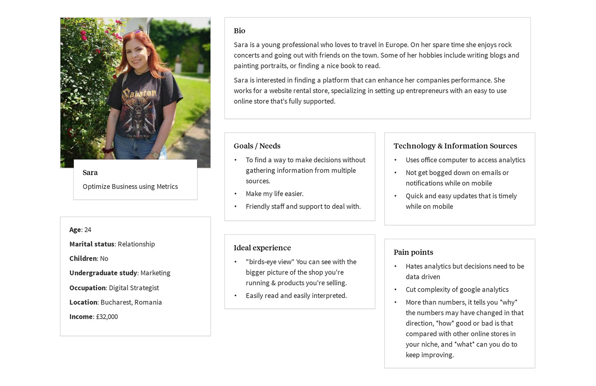

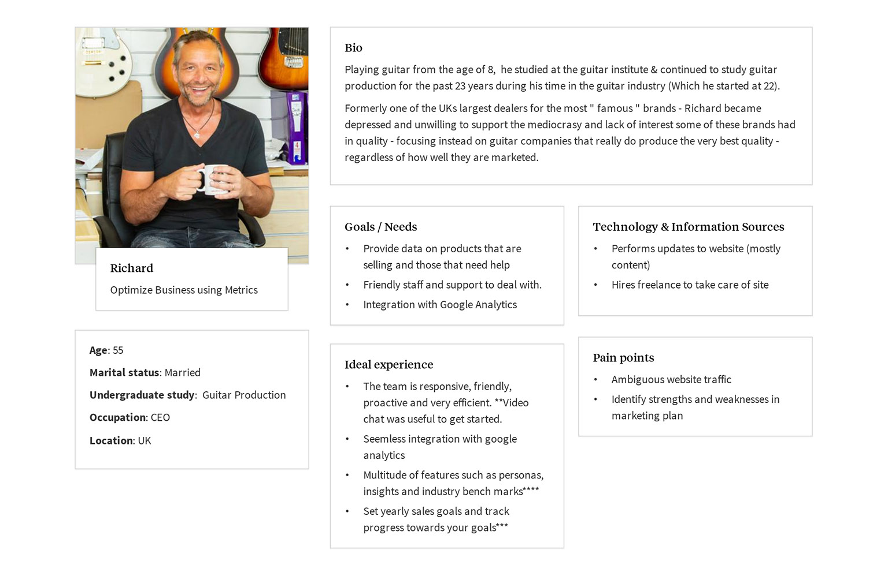

## Roles and Responsibilities

As I mentioned earlier, we’re a very small company comprised of five marketers, designers and developers who’ve been in the digital marketing agency game for years. We’ve been acting as lean as possible, working closely on the Analytics app with each stakeholder since September 2019. I’ve been leading the design of Analytics app working closely with our CEO back end developer and our front end developer wizard part time. I’m also in charge of any future of other future apps or assisting where I’m needed.

## Understanding Our Scope

With a daunting start I needed to be knowledgeable in each aspect of an online business to provide them any value. Luckily for me researching is one of my favourite things to do. Our competition has a lot of strong features and it was my job to identify those traits and research why they chose to feature those things. I incorporated some clever features such as an alerts and insights cards that can help our users what’s going on at a glance or grade reports that combines all of our data into an easy to read feature. We plan to fully launch the app in February 2020. Because this is my side gig along with my full time work, I’ve had to sadly cut out some UX processes to ensure that my full time developers time is utilized to its fullest potential. This means that when the app is launched, I will dig into more UX workflows and try to make sure our app has the best experience I can make for the future.

## Process

Before I began anything, I established a Trello board to help keep myself organized and set reminders for any tasks that’s due.

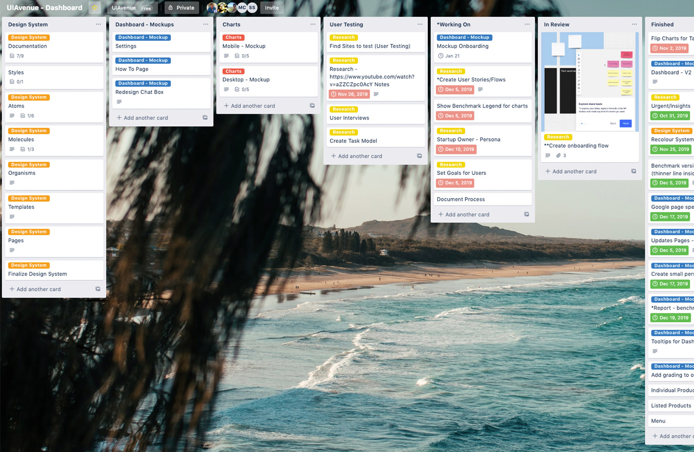

## Wireframing

By creating multiple wireframe iterations focusing on mobile and doing basic usability testing by getting feedback from the product stakeholders, I was able to help position us with a clear competitive advantage from the start. This was also where a majority of my brainstorming and understanding how the app started. I began to flush out different key features and how the user would interact with them. I find it easier to get all my thoughts down on paper where I can interpret things more clearly.

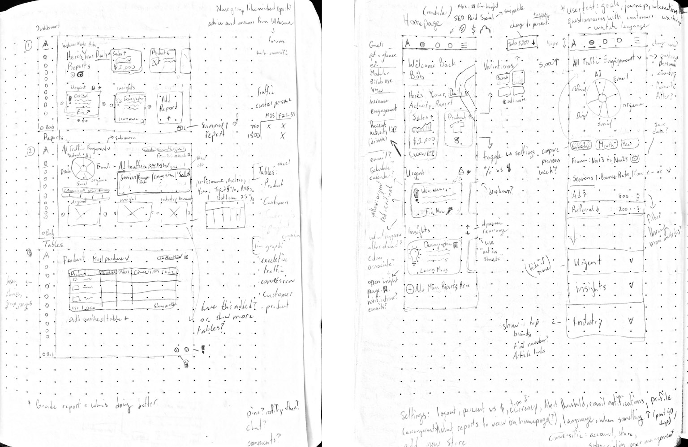

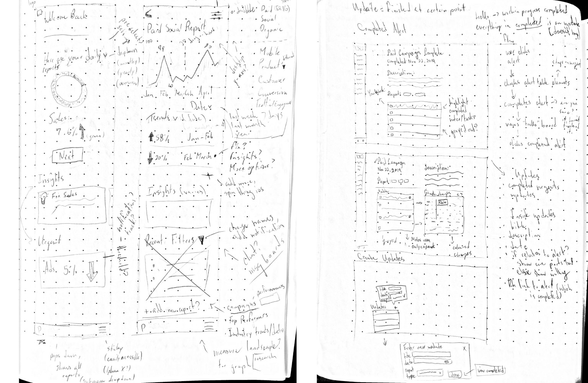

Just a small portion of my wireframes

## Understanding the Onboarding Process

During our onboarding process I’ve aimed to help users understand that we have solutions to their problems. “Customers with a positive perception of their onboarding experience are far less likely to churn within the first 21 days of using a new product” The first steps are reminders about the personal info that we’re grabbing and slowly asking users personal questions. Since our app takes a very long time to grab data from places like google analytics (unless their starting without it) our users will be given a loading bar and percentage outlining things that’s going on in the background so they’re not left alone. To further their experience, users will set up their trackable sales goals aka KPI’s (Key Performance Indicators). They’ll also be given access to the site while things are loading and seeing empty states acknowledging loading time. Prioritizing access to support during their set up and afterwards will help drive our mission to help users sort through their data and understand our app. As Julie Zhou, VP of Product Design at Facebook says: "No one cares about the thing you’ve designed until they get past the beginning"

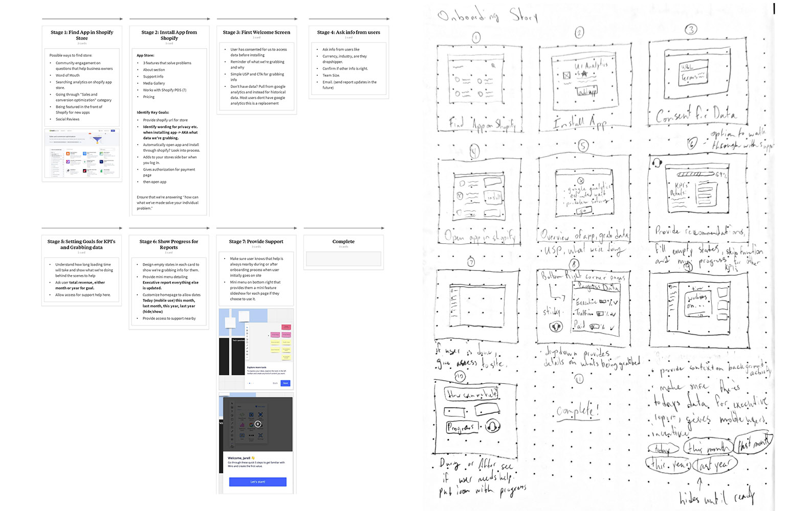

## Creating a Design System

I created my design system by establishing harmonious resizable layouts and testing our multiple variations of colours for charts and greys. Maintenance soon became a breeze with the help of Sketch add ons like Lazy Styles and Find and Replace Layers. The toughest challenge was creating consistent card designs, and once I ironed out how card sizes can be mixed and matched as per layout, designing for desktop was easily translated to mobile saving time.

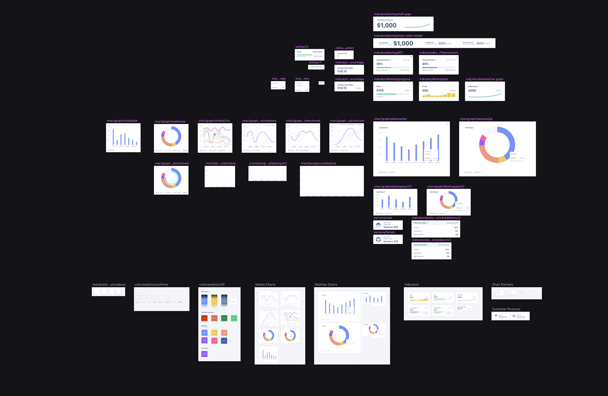

## Style Guide

I created a style guide ensuring each component is documented to ensure all of our stakeholders were kept up to date. Zeplin was a huge help when it came to exporting designs quickly to Dev.

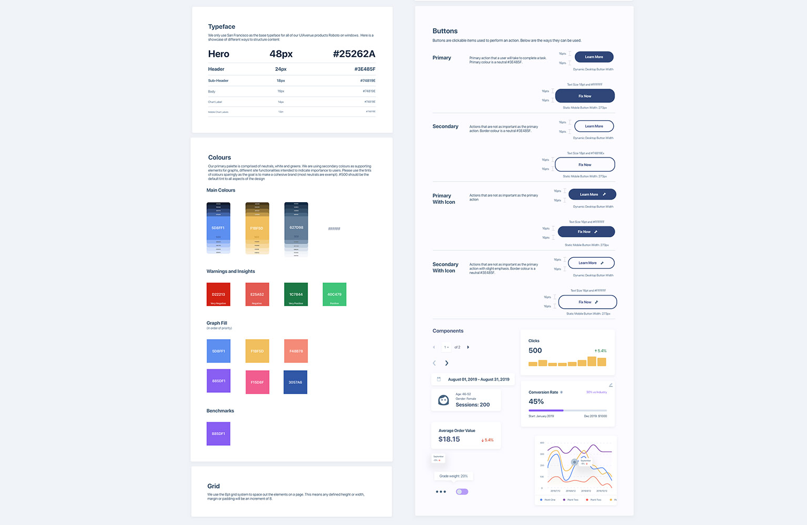

## Final Product

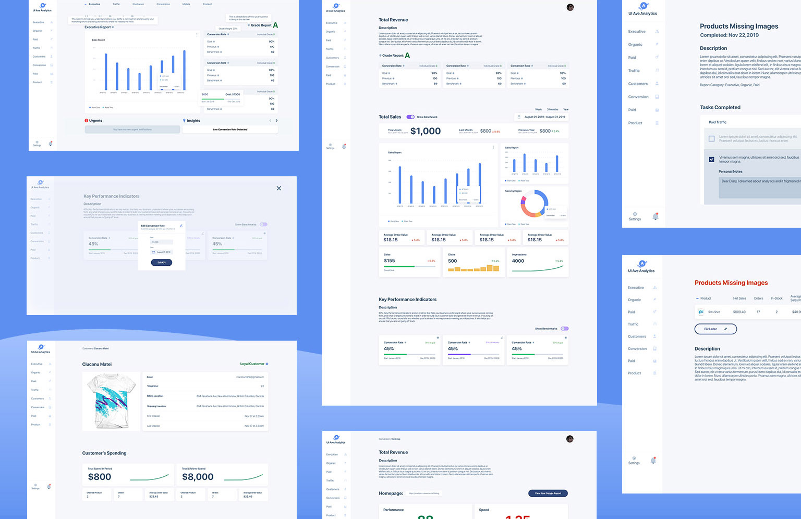

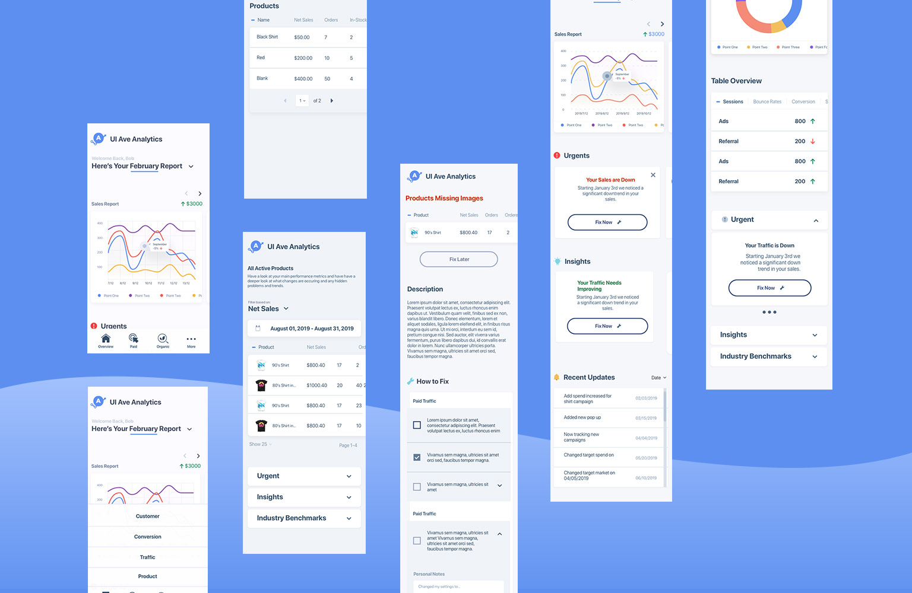

## What happened next

We launched the app. The plan after that was to keep going: user testing, interviews, customizable reports, more personas. A few months later, in mid-2020 at the start of the pandemic, UI Avenue closed, so that work stopped there.

Overall this was the greatest challenge of my career up to that point, and I enjoyed every minute of it while learning so much. Communication with all the stakeholders from the start is the key to any project, and understanding the users' perspectives and doing plenty of research is incredibly important.
